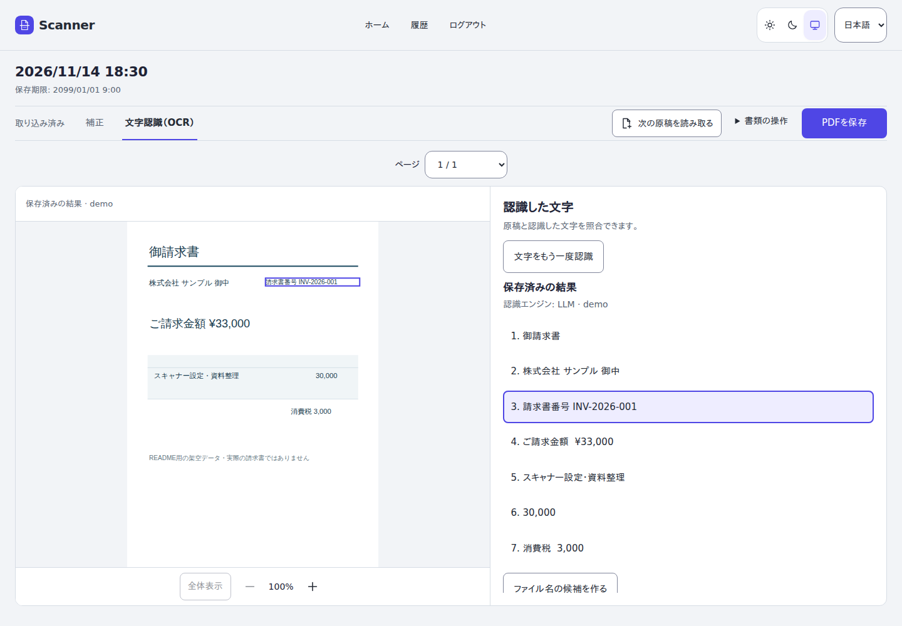
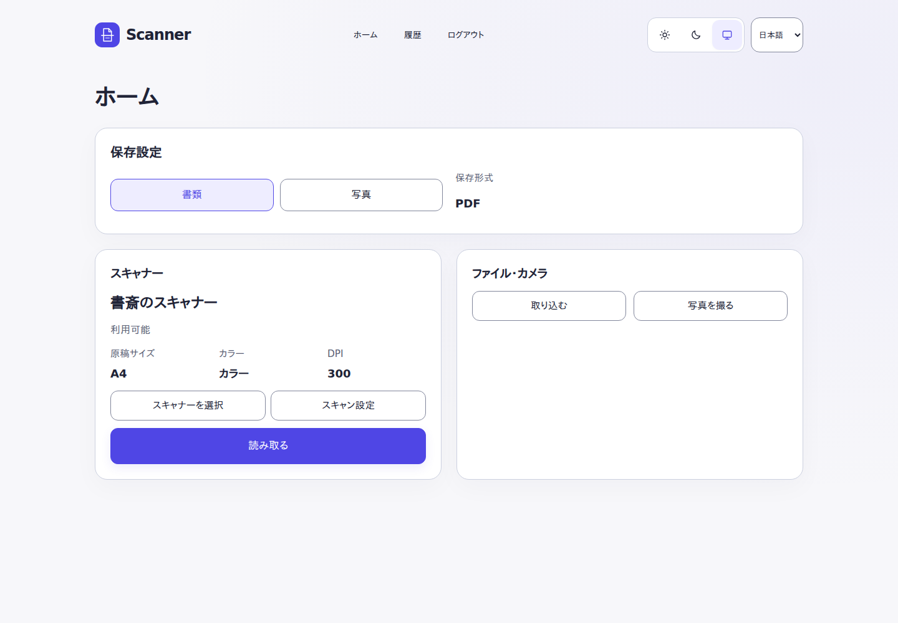
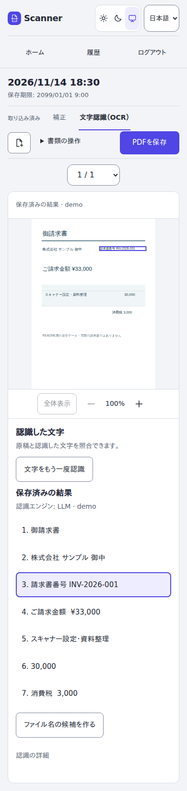

# Scanner Kiosk

**スキャナーも、スマホ写真も、PDFも。取り込みから文字認識、保存までをブラウザで。**

Scanner Kioskは、家庭や小さなオフィス向けのセルフホスト型スキャンアプリです。
PCにもスマートフォンにも、専用のクライアントアプリは不要。紙を読み取り、写真やPDFを取り込み、必要なページを整えて保存できます。

[はじめる](docs/guide/getting-started.md) · [使い方](docs/guide/usage.md) · [最新版をダウンロード](https://github.com/otama-homelab/scanner-kiosk/releases/latest) · [ドキュメント一覧](docs/README.md)

*実際のアプリ画面に架空の請求書とデモOCR結果を表示しています。個人文書は使用していません。*

## できること

| | 機能 |
| --- | --- |
| 紙を取り込む | 対応するSANE／eSCL・AirScanスキャナーから読み取り。LAN上の対応機器を自動検出し、複数台から選択できます。 |
| スマホから取り込む | カメラ撮影、PDF・JPEG・PNGのアップロード。書類と写真の用途を選べます。 |
| ページを整える | 回転・並べ替え・削除・追加・差し替え。対応する画像では手動切り抜きと取り消しが使えます。 |
| 文字を認識する | 日本語・英語のTesseract OCR、または設定したLLMのVision API。原稿画像と認識結果を見比べ、再OCR結果の採用・破棄を選べます。LLMのレイアウト・内容解釈は、原文と区別したPDF内の補足として残します。 |
| 保存する | 書類はPDF、写真はJPEG／PNG。OCRを設定すれば検索可能なPDFを作成できます。OCRなしの保存にも対応します。 |
| 日常で使う | 日本語／英語、ライト／ダーク、スマートフォン／PC表示。文書は利用者ごとに管理し、保存期間の経過後に自動削除します。 |

スマートフォンの画面を見る

## はじめる

推奨環境は **Linux amd64・Docker Compose・HTTPS** です。配布済みimageを使う場合、GoやNode.jsをインストールする必要はありません。

1. [最新Release](https://github.com/otama-homelab/scanner-kiosk/releases/latest)から配布物と対応するimageを選びます。
2. [導入ガイド](docs/guide/getting-started.md)に沿って保存先・URL・ログイン方法を設定し、APIとworkerを起動します。
3. ブラウザでアクセスして、スキャナーまたはファイル・カメラから取り込みます。
4. 必要なら補正・OCRを行い、保存します。

既存のKubernetesで運用する場合は[配備設定](deploy/README.md)を参照してください。
配布ファイルの選び方は[配布物の構成](docs/distribution.md)、設定項目は[環境変数一覧](.env.example)にまとめています。

## OCRとデータの扱い

- **OCRは任意です。** 未設定でも通常のPDF・画像保存を利用できます。
- **Tesseract OCR**は、別コンテナのOCR APIへ画像を送ります。日本語・英語の辞書を同梱した公式imageを利用できます。
- **LLM OCR**は、設定したChat Completions対応Vision APIへ画像を送ります。送信先の処理・保持方針を確認してから有効化してください。
- 接続用の認証情報はworker側で扱い、ブラウザへ渡しません。
- 任意処理中も原本・保存済み出力を保持し、再OCR結果は明示的に採用します。文書は一時保存です。必要な出力は期限前にダウンロードしてください。

LLM補足もPDFから検索・コピーできます。補足にだけ含まれる語でも検索にヒットするため、[Paperlessとの組み合わせ](docs/guide/paperless.md)を確認してください。

認識精度は原稿・モデル・設定に依存します。自動のAI歪み補正や影除去は製品採用済みの機能として提供していません。

## 構成と開発

利用者向けの説明は`docs/guide/`、配備例は`deploy/`、設計・検証記録は`docs/design/`に分けています。
アプリケーションはGoとAstroで構成し、フロントエンドをGo実行ファイルへ埋め込んでいます。

- [開発環境・ソース構成](docs/development.md)
- [配布物と対応するソース・SBOM](docs/distribution.md)
- [設定と運用のドキュメント一覧](docs/README.md)
- [変更履歴](CHANGELOG.md)

## ライセンス

プロジェクトのコード・独自アセットは[Apache-2.0](LICENSE)。同梱するライブラリ、フォント、ネイティブ実行ファイルにはそれぞれのライセンスが適用されます。[第三者ライセンス](THIRD-PARTY-NOTICES.md)も確認してください。
