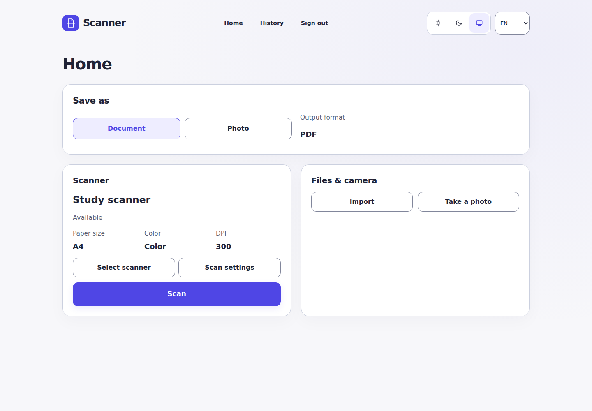

<div align="center">

# Scanner Kiosk

**From paper, photos, and PDFs to searchable documents — in your browser.**

A self-hosted scanning workspace for home and small-office use.

[](https://github.com/otama-homelab/scanner-kiosk/releases/latest)
[](https://github.com/otama-homelab/scanner-kiosk/actions/workflows/checks.yml)
[](LICENSE)

[Features](#features) · [Screenshots](#screenshots) · [Quick start](#quick-start) · [Documentation](docs/README.md) · [Releases](https://github.com/otama-homelab/scanner-kiosk/releases)

</div>


## What is Scanner Kiosk?

Scan a paper document, upload a PDF or image, or take a photo from your phone. Review the pages, run optional OCR, and download the result. Use the same web interface on desktop and mobile, without installing a dedicated client.

Keep a usable saved result while you compare new OCR candidates. Choose when to adopt or discard them, and retain the original throughout optional processing.

## Features

| Workflow | What you can do |
| --- | --- |
| **Scan** | Capture from supported SANE/eSCL/AirScan scanners. Discover compatible LAN devices and choose between registered scanners. |
| **Import** | Upload PDF, JPEG, or PNG files, or use your phone camera. Choose document or photo output before importing. |
| **Review** | Rotate, reorder, delete, add, or replace pages. Crop and undo supported image edits. |
| **Recognize** | Use Japanese/English Tesseract OCR or a configured compatible vision LLM. Compare recognized text with the source image and review new candidates before adoption. |
| **Understand** | Embed the LLM's layout/content interpretation as a separately labeled, searchable PDF supplement. |
| **Export** | Save documents as PDF and photos as JPEG/PNG. Create searchable PDFs with OCR, or save without OCR. |
| **Self-host** | Use English/Japanese, light/dark themes, configurable retention, and the project's authentication options. |

Automatic AI dewarping and shadow removal are not qualified production features. OCR quality depends on the document, model, and configuration.

## Screenshots



<details>
<summary>Mobile OCR view</summary>


</details>

These are captures of the real application using a synthetic invoice and demo OCR data. They do not contain private documents or demonstrate model accuracy. See [screenshot provenance](docs/screenshots/README.md).

## Quick start

**Recommended: Linux amd64, Docker Compose, local storage, and an HTTPS reverse proxy.** Released images do not require Go or Node.js on the host.

1. Download `scanner-deployment.tar` and `SHA256SUMS` from the [latest release](https://github.com/otama-homelab/scanner-kiosk/releases/latest).
2. Verify the archive, then unpack it:

   ```sh
   awk '$2 == "scanner-deployment.tar" { print; found=1 } END { if (!found) exit 1 }' SHA256SUMS | sha256sum --check -
   mkdir scanner-kiosk
   tar -xf scanner-deployment.tar -C scanner-kiosk
   cd scanner-kiosk
   ```

3. Follow the [installation guide](docs/guide/getting-started.md) to prepare storage, pin the release image digest, configure HTTPS, and create an account.
4. Start with an uploaded image, save a PDF, then enable scanner acquisition and optional OCR.

The [installation guide](docs/guide/getting-started.md) includes complete Compose commands and a reverse-proxy example. For existing Kubernetes installations, see the [deployment reference](deploy/README.md). Use files and image digests from the same release; see [release artifacts](docs/distribution.md).

## OCR and privacy

- **OCR is optional.** Ordinary PDF/image export remains available without an OCR provider.
- **Tesseract** processes images in the separate OCR service. The released service image includes Japanese and English language data.
- **LLM OCR** sends images to the configured Chat Completions-compatible vision endpoint. Review that service's processing and retention policy before enabling it. Credentials stay with the worker and are not sent to the browser.
- **Documents expire.** Download the files you need before their retention deadline. Optional processing preserves the original and existing saved output; OCR candidates require explicit adoption.
- **Interpretations are searchable too.** The PDF labels them `LLM supplement (interpretation, not OCR)`. They can contain mistakes and match words absent from the original. See [Paperless compatibility](docs/guide/paperless.md).

Existing OCR/PDF artifacts are immutable. To use a newer recognition implementation, create a new OCR candidate, review it, and explicitly adopt it.

## Documentation and development

| I want to… | Start here |
| --- | --- |
| Install and configure the app | [Getting started](docs/guide/getting-started.md) |
| Scan, review, recognize, and save | [User guide](docs/guide/usage.md) |
| Diagnose a problem | [Troubleshooting](docs/guide/usage.md#troubleshooting) |
| Use Paperless-ngx | [Paperless guide](docs/guide/paperless.md) |
| Choose or verify a release artifact | [Distribution](docs/distribution.md) |
| Build or contribute a change | [Development](docs/development.md) |
| Browse configuration and technical references | [Documentation index](docs/README.md) |

Built with Go and Astro. The frontend is embedded in the Go executable. [Changelog](CHANGELOG.md) · [API specification](https://github.com/otama-homelab/scanner-kiosk/blob/main/api/openapi.json) · [Report an issue](https://github.com/otama-homelab/scanner-kiosk/issues)

When reporting a problem, include the version, deployment method, browser, selected OCR provider, and a redacted error description. Do not attach private originals, recognized text, credentials, or session cookies.

## License

Project code and original assets are licensed under [Apache-2.0](LICENSE). Bundled libraries, fonts, and native tools retain their own licenses; see [third-party notices](THIRD-PARTY-NOTICES.md) and the corresponding release materials.
