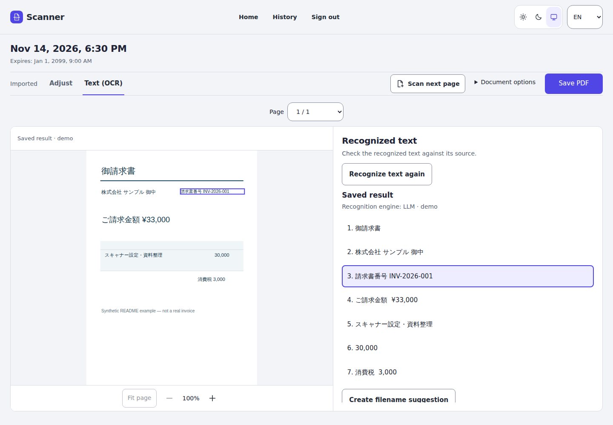
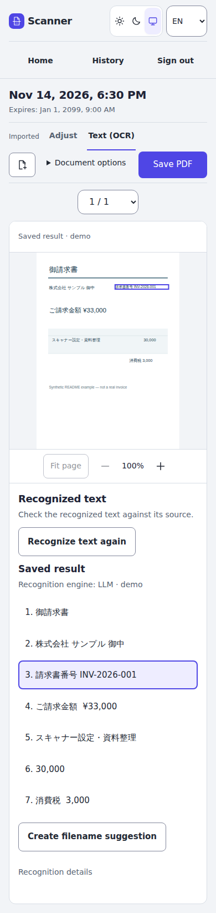

<div align="center">

# Scanner Kiosk

**From paper, photos, and PDFs to searchable documents — in your browser.**

A self-hosted scanning workspace for home and small-office use.

[](https://github.com/otama-homelab/scanner-kiosk/releases/latest)
[](https://github.com/otama-homelab/scanner-kiosk/actions/workflows/checks.yml)
[](LICENSE)

[Features](#features) · [Screenshots](#screenshots) · [Quick start](#quick-start-docker) · [Documentation](docs/README.md) · [Releases](https://github.com/otama-homelab/scanner-kiosk/releases)

</div>



## What is Scanner Kiosk?

Scan a paper document, upload a PDF or image, or take a photo from your phone. Review the pages, run optional OCR, and download the result. Use the same web interface on desktop and mobile, without installing a dedicated client.

Keep a usable saved result while you compare new OCR candidates. Choose when to adopt or discard them, and retain the original throughout optional processing.

## Features

| Workflow | What you can do |
| --- | --- |
| **Scan** | Capture from supported SANE/eSCL/AirScan scanners. Discover compatible LAN devices and choose between registered scanners. |
| **Import** | Upload PDF, JPEG, or PNG files, or use your phone camera. Choose document or photo output before importing. |
| **Review** | Rotate, reorder, delete, add, or replace pages. Crop and undo supported image edits. |
| **Recognize** | Use Japanese/English Tesseract OCR or a configured compatible vision LLM. Compare recognized text with the source image and review new candidates before adoption. |
| **Understand** | Optionally embed the LLM's layout/content interpretation as a separately labeled, searchable PDF supplement. |
| **Export** | Save documents as PDF and photos as JPEG/PNG. Create searchable PDFs with OCR, or save without OCR. |
| **Self-host** | Use English/Japanese, light/dark themes, configurable retention, and the project's authentication options. |

Automatic AI dewarping and shadow removal are not qualified production features. OCR quality depends on the document, model, and configuration.

## Screenshots


<details>
<summary>Mobile OCR view</summary>



</details>

These are captures of the real application using a synthetic invoice and demo OCR data. They do not contain private documents or demonstrate model accuracy. See [screenshot provenance](docs/screenshots/README.md).

## Quick start (Docker)

Run the released image with **Docker Engine on Linux amd64**. The API and worker are separate containers sharing two local storage directories. You also need an HTTPS reverse proxy; Go, Node.js, and Compose are not required.

### 1. Choose an image and prepare storage

Set the **core image repository digest** from the [release you want to install](https://github.com/otama-homelab/scanner-kiosk/releases/latest). Replace the placeholder below, then pull the image:

```sh
SCANNER_IMAGE=ghcr.io/otama-homelab/scanner-kiosk@sha256:REPLACE_WITH_RELEASE_CORE_DIGEST
docker pull "$SCANNER_IMAGE"
mkdir scanner-kiosk
cd scanner-kiosk
sudo install -d -m 700 -o 10001 -g 10001 /srv/scanner/state /srv/scanner/documents
```

The storage command is for a new installation using UID/GID `10001:10001`. For existing data, rootless Docker, or user namespaces, follow the [storage guide](docs/guide/getting-started.md#storage-and-runtime-identity) first.

### 2. Create `scanner.env`

Replace the hostname with the HTTPS URL you will use:

```dotenv
SCANNER_PUBLIC_URL=https://scanner.example.com
SCANNER_LISTEN_ADDR=:8080
SCANNER_STATE_DIR=/var/lib/scanner/state
SCANNER_DOCUMENT_DIR=/var/lib/scanner/documents
SCANNER_AUTHENTICATE_TYPE=simple
SCANNER_ACQUISITION_ENABLED=true
SCANNER_DISCOVERY_ENABLED=false
SCANNER_SCANNERS_JSON=[]
SCANNER_OCR_PLUGINS=
```

### 3. Start the API and worker

```sh
chmod 600 scanner.env
docker run -d --name scanner-api --restart unless-stopped \
  --init --user 10001:10001 --read-only \
  --tmpfs /tmp:rw,exec,nosuid,nodev,size=512m,mode=1777 \
  --cap-drop ALL --security-opt no-new-privileges:true \
  --memory 512m --cpus 1 --stop-timeout 180 \
  --env-file scanner.env --publish 127.0.0.1:8080:8080 \
  --mount type=bind,src=/srv/scanner/state,dst=/var/lib/scanner/state \
  --mount type=bind,src=/srv/scanner/documents,dst=/var/lib/scanner/documents \
  "$SCANNER_IMAGE" serve

docker run -d --name scanner-worker --restart unless-stopped \
  --init --user 10001:10001 --read-only \
  --tmpfs /tmp:rw,exec,nosuid,nodev,size=512m,mode=1777 \
  --cap-drop ALL --security-opt no-new-privileges:true \
  --memory 1536m --cpus 2 --stop-timeout 180 \
  --env-file scanner.env --env GOMEMLIMIT=1024MiB --env OMP_THREAD_LIMIT=1 \
  --mount type=bind,src=/srv/scanner/state,dst=/var/lib/scanner/state \
  --mount type=bind,src=/srv/scanner/documents,dst=/var/lib/scanner/documents \
  "$SCANNER_IMAGE" worker
```

OCR is optional. This starts file import and ordinary PDF/image export without an OCR service.

### 4. Create an account and open the app

In Bash, read the password without echoing it and pass it through standard input:

```bash
read -r -s -p 'Scanner password: ' scanner_password
printf '\n'
printf '%s\n' "$scanner_password" | docker exec -i scanner-api /usr/local/bin/scanner user create admin
unset scanner_password
```

Forward your HTTPS hostname to `127.0.0.1:8080` on the Docker host. With Caddy running on that host:

```caddyfile
scanner.example.com {
    reverse_proxy 127.0.0.1:8080
}
```

Open your URL, sign in, upload an image, and save a PDF. A proxy in another container needs an appropriate network upstream; its own loopback address is not the Docker host.

For service checks, scanner networking, OCR, and upgrades, use the [Docker run guide](docs/guide/getting-started.md). Prefer declarative deployment? See [Docker Compose](docs/guide/docker-compose.md) or the [Kubernetes reference](deploy/README.md).

## OCR and privacy

- **OCR is optional.** Ordinary PDF/image export remains available without an OCR provider.
- **Tesseract** processes images in the separate OCR service. The released service image includes Japanese and English language data.
- **LLM OCR** sends images to the configured Chat Completions-compatible vision endpoint. Review that service's processing and retention policy before enabling it. Credentials stay with the worker and are not sent to the browser.
- **Documents expire.** Download the files you need before their retention deadline. Optional processing preserves the original and existing saved output; OCR candidates require explicit adoption.
- **Optional interpretations are searchable too.** Supplements are off by default; the checkbox choice is remembered in this browser. The PDF labels them `LLM supplement (interpretation, not OCR)`. They can contain mistakes and match words absent from the original. See [Paperless compatibility](docs/guide/paperless.md).

Existing OCR/PDF artifacts are immutable. To use a newer recognition implementation, create a new OCR candidate, review it, and explicitly adopt it.

## Documentation and development

| I want to… | Start here |
| --- | --- |
| Install and configure the app | [Getting started](docs/guide/getting-started.md) |
| Scan, review, recognize, and save | [User guide](docs/guide/usage.md) |
| Diagnose a problem | [Troubleshooting](docs/guide/usage.md#troubleshooting) |
| Use Paperless-ngx | [Paperless guide](docs/guide/paperless.md) |
| Choose or verify a release artifact | [Distribution](docs/distribution.md) |
| Build or contribute a change | [Development](docs/development.md) |
| Browse configuration and technical references | [Documentation index](docs/README.md) |

Built with Go and Astro. The frontend is embedded in the Go executable. [Changelog](CHANGELOG.md) · [API specification](https://github.com/otama-homelab/scanner-kiosk/blob/main/api/openapi.json) · [Report an issue](https://github.com/otama-homelab/scanner-kiosk/issues)

When reporting a problem, include the version, deployment method, browser, selected OCR provider, and a redacted error description. Do not attach private originals, recognized text, credentials, or session cookies.

## License

Project code and original assets are licensed under [Apache-2.0](LICENSE). Bundled libraries, fonts, and native tools retain their own licenses; see [third-party notices](THIRD-PARTY-NOTICES.md) and the corresponding release materials.
