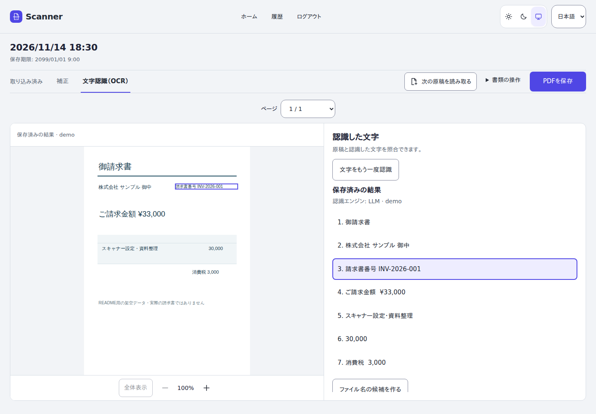
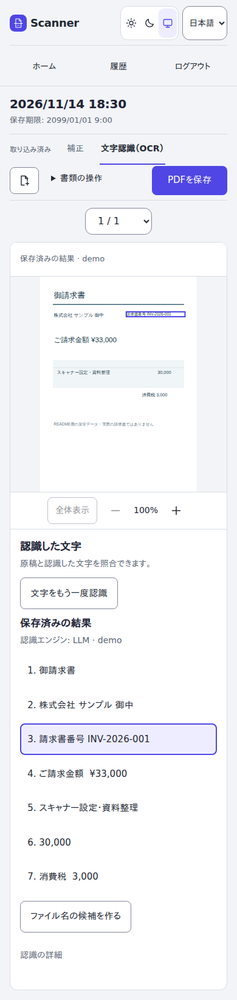

# 使い方

[README](../../README.md) · [導入ガイド](getting-started.md)

## 取り込みから保存まで

1. **用途を選ぶ。** 書類はPDF、写真はJPEG／PNGとして扱います。
2. **取り込む。** ホームからスキャナーで読み取る、ファイルを取り込む、カメラで撮影する、のいずれかを選びます。機器が複数あるときは読み取り先を確認してください。
3. **原稿を整える。** 補正画面でページを回転・並べ替えます。対応する画像では切り抜きと取り消しも利用できます。「書類の操作」から追加・差し替えなどの操作へ進みます。
4. **必要なら文字認識。** OCRが設定されている場合、「文字認識（OCR）」で原稿画像と認識した文字を見比べます。文字を選ぶと、位置情報がある結果では対応する画像領域を強調します。
5. **結果を選び、保存する。** 再OCRは結果を確認して採用または破棄します。保存済みの結果を残したまま比較できます。最後に「PDFを保存」または画像の保存操作を選びます。

## 拡大・ページ操作

画像下の拡大・縮小と「全体表示」を使います。拡大中は画像を移動できます。複数ページの文書はページ選択で切り替えます。
スマートフォンでは原稿と文字を縦に配置します。

画面例は架空データを使った実アプリの撮影です。表示しているOCR結果はデモ用で、実モデルの認識精度を示すものではありません。

## LLMによる補足

LLM OCRでは、レイアウトや内容の解釈を認識原文とは別の情報として保持します。PDFの各ページのOCRテキスト末尾へ`LLM supplement (interpretation, not OCR)`の見出しとともに埋め込みます。画面上の原稿やページ数は変わりません。補足も検索・コピー対象になりますが、原稿に書かれた事実とは限らず、推測や誤りを含みます。

過去に生成したPDFを上書きする機能ではありません。新版のOCR結果を使うには、新しい候補として再認識し、確認して採用してください。

[Paperlessでの検索・再OCRの注意](paperless.md)も参照してください。

## 知っておきたいこと

- 原稿は期限付きです。画面の保存期限までに必要なファイルをダウンロードしてください。
- OCRは原稿やモデルによって誤ることがあります。検索・コピーした文字も確認してください。
- LLM OCRを選ぶと、設定されたサービスへ画像を送信します。送信先の表示と運用方針を確認してください。
- OCR未設定の環境では、認識ボタンが表示されない場合があります。通常の保存は利用できます。
- 回転・切り抜きなどを変更した後は、以前のOCRと新しい原稿の対応に注意してください。再認識は明示的に実行します。
- 任意のAI歪み補正・影除去モデルが自動的に導入されるアプリではありません。

## 困ったとき

| 状況 | 確認すること |
| --- | --- |
| スキャナーが見つからない | 電源、同一LAN、対応機種、Dockerのdiscovery設定。選択済み機器が消えた場合は別の機器へ自動変更しません。 |
| 読み取りが開始できない | workerの起動、取得許可、機器の状態、ジョブ・保存容量の上限。 |
| スマホのカメラが使えない | HTTPSとブラウザのカメラ許可。写真・ファイルからの取り込みも利用できます。 |
| OCRが利用できない | 管理者によるprovider・モデル・フォント・OCR APIの設定。原稿の通常保存は別に確認できます。 |
| OCRの位置や文字がおかしい | 原稿と使用モデル、選んだOCR結果を確認。古い結果の採用を取り消す代わりに、新しい候補として再認識して比較します。 |

設定・ログ・容量の確認は[導入ガイド](getting-started.md)と[配備資料](../../deploy/README.md)を参照してください。
