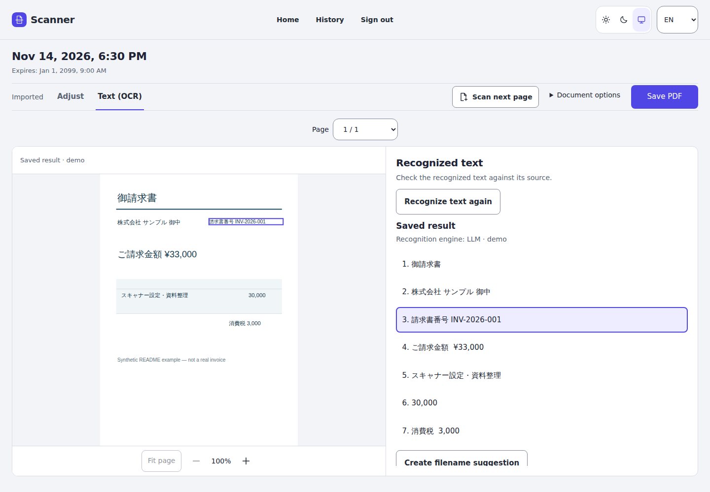
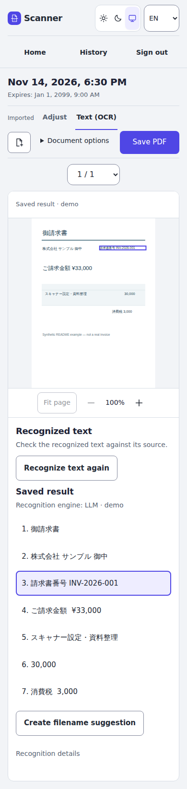

# User guide

[Overview](../../README.md) · [Installation](getting-started.md)

## From import to export

1. **Choose a purpose.** Documents produce PDF output; photos produce JPEG/PNG output.
2. **Import.** Scan from a device, upload a file, or use the camera. Check the selected scanner when several devices are available.
3. **Review the original.** Rotate or reorder pages in the adjustment view. Supported image edits include crop and undo. Use document actions to add or replace pages.
4. **Recognize text, if needed.** Open the OCR view to compare recognized text with the image. Selecting a text line highlights its image region when positions are available.
5. **Review and save.** Adopt or discard a new OCR candidate explicitly. Existing saved output remains available during comparison. Download the PDF or image, then open it to check the result.

## Zoom and page navigation

Use the zoom controls and **Fit page** below the image. Pan while zoomed in, and use the page selector for multi-page documents. The mobile layout stacks the source image and text.

Screenshots use synthetic documents and demo OCR results in the real application. They are not measurements of recognition accuracy.

## OCR candidates and existing output

A new recognition run creates a candidate; it does not silently replace the adopted result. Compare it, then choose whether to adopt or discard it. Optional processing preserves the original and the current saved output.

After an OCR implementation update, create a new candidate to use the new behavior. Existing OCR artifacts and previously generated PDFs are not rewritten in place. If a run fails, keep the existing result and diagnose the failure before retrying.

## LLM interpretation supplements

LLM OCR can interpret a page's layout and content separately from verbatim recognition. The **Include LLM interpretation in PDF** checkbox is off by default. Your choice is remembered in this browser and applies only to LLM OCR. When enabled, each PDF page appends that interpretation to its invisible OCR text under `LLM supplement (interpretation, not OCR)`. The visible original and page count remain unchanged.

Supplements can be searched and copied, but may contain guesses or mistakes. They are not statements printed in the original. Words found only in a supplement can affect search results or automatic classification; see the [Paperless guide](paperless.md).

## Retention and processing

- Download what you need before the displayed retention deadline. The app is temporary document storage.
- Review OCR text before relying on search, copied numbers, or extracted details.
- Choosing LLM OCR sends images to the configured service. Check the displayed destination and its policies.
- OCR controls may be unavailable when no provider is configured. Ordinary export remains available.
- Editing page geometry can make an earlier OCR result unsuitable. Run recognition explicitly when needed.
- Automatic AI dewarping and shadow removal are not qualified production features.

## Troubleshooting

| Symptom | Check |
| --- | --- |
| Scanner is missing | Power, LAN reachability, device support, and Docker discovery networking. A missing selected device is not silently replaced by another. |
| Capture cannot start | Worker startup, acquisition enabled, device state, job limits, free space, and retention/storage limits. |
| Camera is unavailable | HTTPS and browser camera permission. You can also upload a photo or file. |
| OCR is unavailable | Provider, exact model identity, service authentication, and font configuration. Test ordinary export separately. |
| “Text recognition failed” | Preserve the original/current export. Check worker/provider availability, response format, model limits, and font coverage. A model's HTTP success alone does not prove its output passed validation. |
| OCR text or positions look wrong | Check the source, model, and selected candidate. Create a new candidate and compare it before adoption. |
| Download succeeds but search differs in Paperless | Check text extraction, Paperless's OCR mode, and whether a match appears only in an interpretation supplement. |

Administrators can use the [installation guide](getting-started.md) and [deployment reference](../../deploy/README.md) to inspect settings, logs, and capacity. For a bug report, include the version, browser, deployment method, OCR provider, and a redacted description. Do not publish private originals, recognized text, credentials, or cookies.
